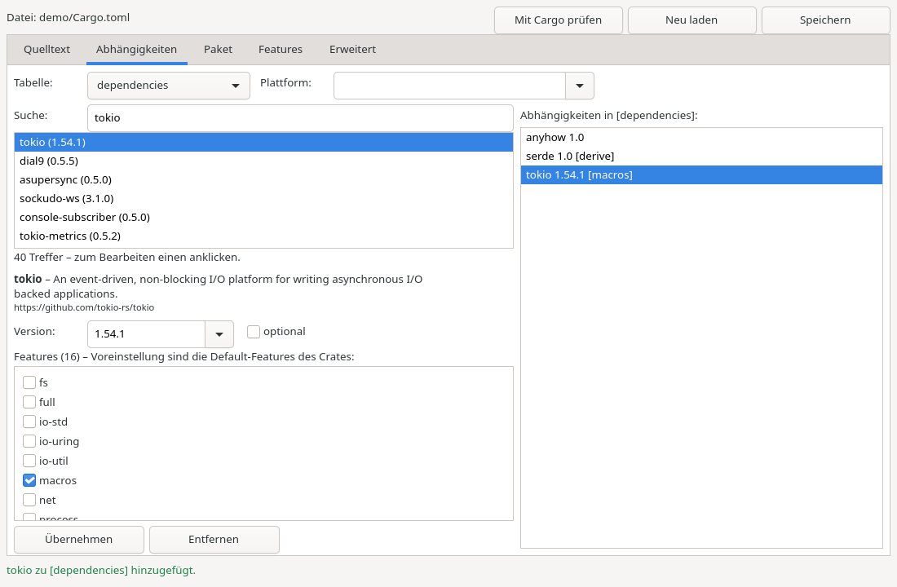

# CT-Editor – Cargo TOML Editor

Visueller Editor für `Cargo.toml`-Dateien – Teil des RAD-Tools **Freya TD**, gebaut
mit [RUF/RNCL](../RUF) – nativ auf Linux (GTK 4), Windows (Win32) und macOS (Cocoa).
*Visual editor for `Cargo.toml` files – part of the RAD tool **Freya TD**, built with
[RUF/RNCL](../RUF) – native on Linux (GTK 4), Windows (Win32) and macOS (Cocoa).*



- **Quelltext** mit Syntax-Hervorhebung und Live-Prüfung · *source with highlighting and live validation*
- **Abhängigkeiten:** Suche auf crates.io (ab 3 Zeichen), Features per Checkbox, Default = Default-Features des Crates · *crates.io search (3+ chars), features as check boxes, preset = the crate's defaults*
- **Paket**, **Features**, **Erweitert** (jeder weitere Abschnitt: `[lib]`, `[[bin]]`, `[profile.*]`, `[workspace]` …) · *full manifest scope*
- formatierungserhaltend (Kommentare bleiben), Prüfung durch `cargo metadata`, Deutsch/Englisch, erweiterbar · *format-preserving, validated by Cargo, i18n*

```bash
ct-editor --lang de --path /pfad/zum/projekt     # Aufruf durch Freya TD
cargo test                                       # Tests (Linux ohne Bildschirm: xvfb-run -a cargo test)
```

## Dokumentation / Documentation

- 🇩🇪 [Handbuch](docs/de/README.md)
- 🇬🇧 [Manual](docs/en/README.md)
- KI / AI: [`AGENTS.md`](AGENTS.md), [`.claude/skills/ct-editor`](.claude/skills/ct-editor/SKILL.md)

## Lizenz / License

Apache-2.0
