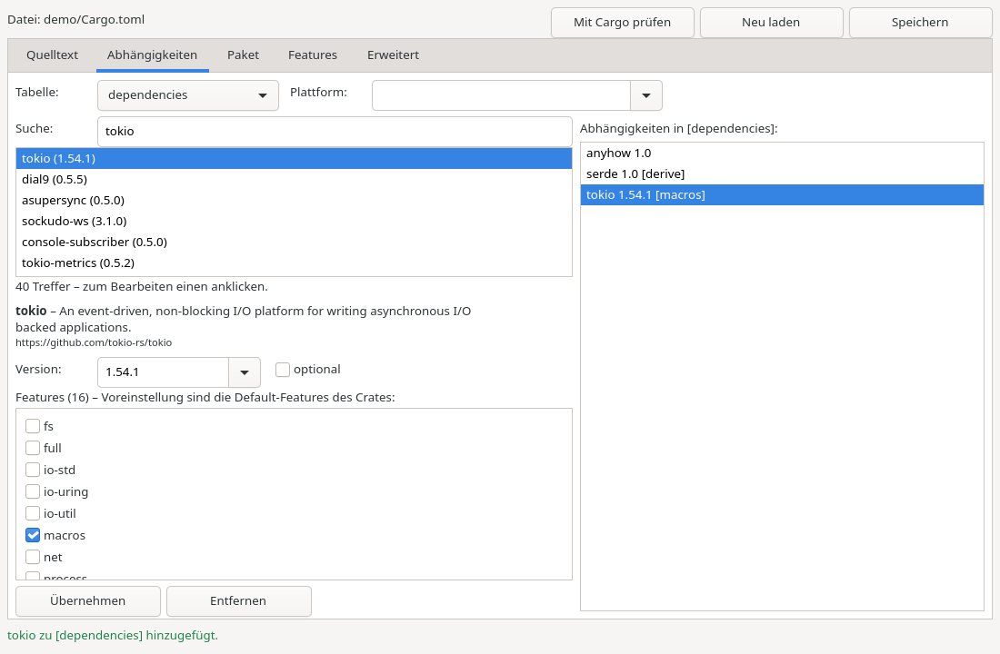
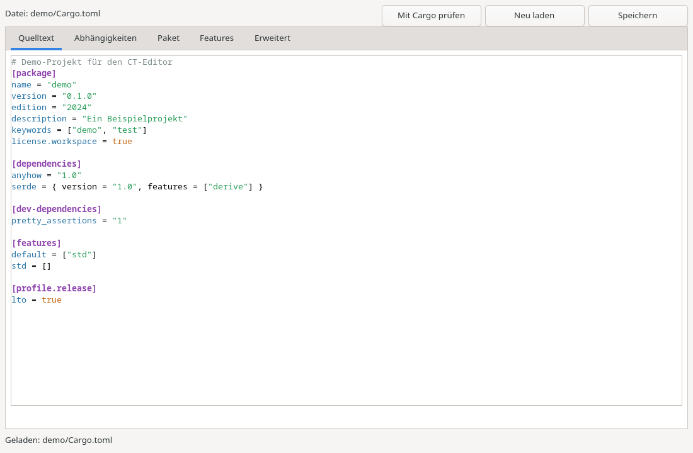
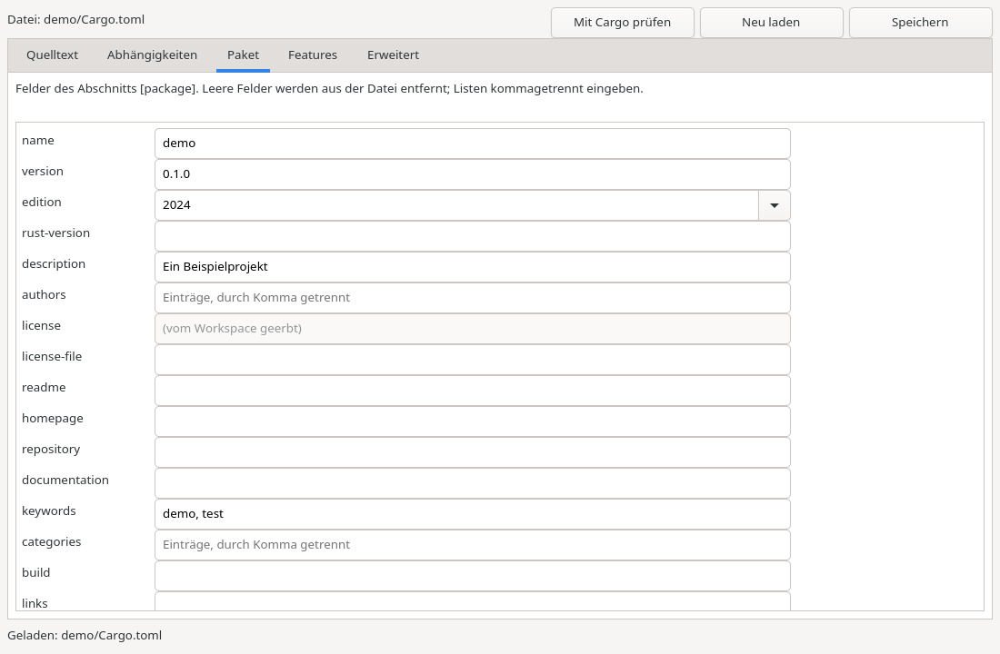

# CT-Editor – Handbuch

Der **CT-Editor** (Cargo-TOML-Editor) ist der visuelle Editor für `Cargo.toml`-Dateien
im RAD-Tool **Freya TD**. Er läuft als eigenständiges Programm, das Freya TD mit
Sprache und Projektordner aufruft.

🇬🇧 [English version](../en/README.md)



## Inhalt

1. [Aufruf](#aufruf)
2. [Die Registerkarten](#die-registerkarten)
3. [Typische Abläufe](#typische-abläufe)
4. [Tastenkürzel](#tastenkürzel)
5. [Sprachen](#sprachen)
6. [Für Entwickler](#für-entwickler)
7. [Arbeiten mit KI](#arbeiten-mit-ki)

## Aufruf

```bash
ct-editor --lang de --path /pfad/zum/projekt     # so ruft Freya TD den Editor auf
ct-editor -l en ./mein-projekt                   # Pfad auch als Positionsangabe
ct-editor --help                                 # alle Optionen
```

| Option | Bedeutung |
|---|---|
| `PROJEKTORDNER` / `-p, --path` | Ordner mit der `Cargo.toml` (Standard: aktueller Ordner) |
| `-l, --lang` | Sprache, z. B. `de`, `en`, `de_DE.UTF-8` (Standard: `LANG`, sonst Englisch) |
| `--locales ORDNER` | zusätzliche Übersetzungsdateien laden |
| `--tab` | Start-Registerkarte: `source`, `dependencies` (Standard), `package`, `features`, `advanced` |
| `--offline` | keine Verbindung zu crates.io |
| `--screenshot BILD.png` | Fenster als Bild speichern und beenden (ohne Bildschirm) |
| `--size 1100x720` | Fenstergröße |

**Gibt es im Ordner keine `Cargo.toml`,** bereitet der Editor eine neue vor
(Paketname = Ordnername, Version 0.1.0, Edition 2024). Die Datei entsteht erst beim
Speichern; die Kopfzeile zeigt bis dahin „Neue Datei“. Eine vorhandene Datei wird
automatisch geladen – auch wenn sie Syntaxfehler enthält (diese werden markiert).

Exit-Code: `0` bei normalem Ende.

## Die Registerkarten

### 1 · Quelltext



Die `Cargo.toml` als Text mit Syntax-Hervorhebung. Nach jeder Tipp-Pause (300 ms)
wird die TOML-Syntax geprüft:

- **gültig** → alle anderen Tabs zeigen den neuen Stand;
- **ungültig** → die Fehlerzeile wird rot hinterlegt, Zeile/Spalte/Ursache stehen
  unten und in der Statuszeile, und die visuellen Tabs sind **gesperrt**, damit
  nichts den Text überschreibt. `F2` springt zur Fehlerstelle.

Kommentare, Leerzeilen und Reihenfolge bleiben beim Bearbeiten in allen Tabs
erhalten – geändert wird nur, was tatsächlich geändert wurde.

### 2 · Abhängigkeiten (visuelle Schicht)

| Bereich | Funktion |
|---|---|
| **Tabelle** | `dependencies`, `dev-dependencies` oder `build-dependencies` |
| **Plattform** | leer = alle; z. B. `cfg(unix)` → `[target.'cfg(unix)'.dependencies]` |
| **Suche** | sucht auf crates.io – **erst ab 3 Zeichen** und nach kurzer Tipp-Pause (Enter sucht sofort) |
| **Treffer** | die gefundenen Crates mit empfohlener Version |
| **Details** | nach Klick auf einen Treffer: Kurzbeschreibung, Link, Version, *optional* |
| **Features** | alle Features der gewählten Version als Checkboxen. **Voreinstellung = die Default-Features des Crates.** Tooltip: was ein Feature aktiviert |
| **Hinzufügen / Übernehmen** | schreibt die Abhängigkeit ins Manifest |
| **Entfernen** | löscht die gewählte Abhängigkeit |
| **rechte Liste** | alle Abhängigkeiten der gewählten Tabelle; Klick lädt sie zum Bearbeiten |

So entsteht der Eintrag – wie bei `cargo add`:

| Auswahl | Ergebnis |
|---|---|
| nur Default-Features | `serde = "1.0.229"` |
| Default + `derive` | `serde = { version = "1.0.229", features = ["derive"] }` |
| Default `std` abgewählt, `rc` gewählt | `serde = { version = "1.0.229", default-features = false, features = ["rc"] }` |
| *optional* angehakt | `…, optional = true` |

Die Version ist frei editierbar (`1.0`, `^0.9`, `=1.2.3`). Die Feature-Liste folgt
der passenden Version. Bestehende Schreibweisen bleiben erhalten: eine
`[dependencies.tokio]`-Tabelle bleibt eine Tabelle, unbekannte Schlüssel (`registry`,
`branch`…) bleiben stehen, eine alphabetisch sortierte Tabelle bleibt sortiert.
Pfad-, Git- und Workspace-Abhängigkeiten lassen sich ebenfalls bearbeiten.

### 3 · Paket



Formular für `[package]`: Name, Version, Edition, rust-version, Beschreibung,
Autoren, Lizenz, Links, Schlüsselwörter, Kategorien, Build-Skript, publish, auto*-
Schalter … Jede Eingabe wirkt sofort; ein leeres Feld wird entfernt, Listen werden
kommagetrennt eingegeben. Vom Workspace geerbte Felder (`license.workspace = true`)
sind gekennzeichnet und nur im Quelltext änderbar. Tooltips erklären jedes Feld.

### 4 · Features

Die eigenen Features des Pakets (`[features]`): Feature wählen oder **Neu**, Name und
aktivierte Einträge eingeben (`std, dep:serde, serde/derive`), **Übernehmen**. Den Namen
eines markierten Features ändern und übernehmen = umbenennen.

### 5 · Erweitert

Jeder Abschnitt der Datei einzeln als TOML – damit ist der **volle Umfang** einer
`Cargo.toml` erreichbar: `[lib]`, `[[bin]]`, `[[example]]`, `[[test]]`, `[[bench]]`,
`[profile.*]`, `[workspace]`, `[lints]`, `[patch]`, `[replace]`, `[badges]`,
`[target.*]`, `[package.metadata]` … Neue Abschnitte entstehen aus **Vorlagen**.
Fehlerhaftes TOML wird nicht übernommen, die Fehlerzeile wird markiert.

### Werkzeugleiste

| Knopf | Funktion |
|---|---|
| **Speichern** | schreibt die Datei (legt den Ordner bei Bedarf an). Mit Syntaxfehler wird nicht gespeichert |
| **Neu laden** | liest die Datei erneut (fragt bei ungespeicherten Änderungen) |
| **Mit Cargo prüfen** | lässt Cargo selbst das Manifest prüfen (`cargo metadata --no-deps --offline`): Pflichtfelder, gültige Edition, Workspace-Bezüge … |

Beim Schließen mit ungespeicherten Änderungen fragt der Editor nach.

## Typische Abläufe

**Crate hinzufügen:** Tab *Abhängigkeiten* → `serde` tippen → Treffer `serde` anklicken
→ Feature `derive` anhaken → **Hinzufügen** → `Strg+S`.

**Features einer vorhandenen Abhängigkeit ändern:** rechts die Abhängigkeit anklicken
→ Häkchen setzen/entfernen → **Übernehmen**.

**Plattformspezifische Abhängigkeit:** *Plattform* = `cfg(windows)` → suchen → hinzufügen.

**Release-Profil anlegen:** Tab *Erweitert* → Vorlage `profile` → **Vorlage einfügen** →
anpassen → **Übernehmen**.

## Tastenkürzel

| Taste | Funktion |
|---|---|
| `Strg+S` | Speichern |
| `F5` | Mit Cargo prüfen |
| `F2` | zum Syntaxfehler springen |
| `Enter` im Suchfeld | sofort suchen |

## Sprachen

Die Texte liegen in `locales/<sprache>.toml` (eingebettet: `de`, `en`). Fehlt eine
Sprache, wird auf die Hauptsprache (`de-AT` → `de`) und dann auf Englisch
zurückgegriffen.

**Neue Sprache ohne Neukompilieren:** `locales/en.toml` nach z. B. `fr.toml` kopieren,
Werte übersetzen, Schlüssel und `{Platzhalter}` unverändert lassen, dann:

```bash
ct-editor --locales /pfad/zu/meinen/locales --lang fr --path projekt
```

Dateien im `--locales`-Ordner ergänzen oder überschreiben auch eingebettete Sprachen.
Um eine Sprache fest einzubauen, die Datei nach `locales/` legen und in
`src/i18n.rs` (`EMBEDDED`) eintragen – der Test `languages_are_complete` prüft, dass
alle Schlüssel vorhanden sind.

## Für Entwickler

### Voraussetzungen

Rust ≥ 1.99 und unter Linux GTK 4 mit Entwicklungsdateien (Windows und macOS brauchen nichts weiter) –
wie für RUF (`../RUF/docs/de/erste-schritte.md`).

```bash
cd CT-Editor
cargo run -- --lang de --path ../RUF                 # Editor starten
cargo test                                           # Logik- und GUI-Tests (Linux ohne Bildschirm: xvfb-run -a cargo test)
cargo test -- --ignored live_crates_io               # Test gegen das echte crates.io
cargo clippy --all-targets                           # muss warnungsfrei sein
```

### Aufbau

```
CT-Editor/
├── src/
│   ├── main.rs          Start: CLI auswerten, Sprache, Application, Editor
│   ├── lib.rs           Bibliothek (alles außer main.rs ist wiederverwendbar)
│   ├── cli.rs           Kommandozeile (clap)
│   ├── i18n.rs          Übersetzungen, Makro tr!
│   ├── manifest.rs      Cargo.toml-Modell auf toml_edit (ohne Oberfläche)
│   ├── features.rs      Feature-Checkboxen ⇄ features/default-features (ohne Oberfläche)
│   ├── crates_io.rs     crates.io-Client + Trait CrateSource (ohne Oberfläche)
│   ├── cargo_cli.rs     Prüfung per cargo metadata (ohne Oberfläche)
│   └── ui/              Oberfläche (RUF/RNCL)
│       ├── mod.rs       Editor, gemeinsamer Zustand, Speichern/Laden/Prüfen
│       ├── source_tab.rs, deps_tab.rs, package_tab.rs, features_tab.rs, advanced_tab.rs
├── locales/             de.toml, en.toml
├── tests/gui.rs         GUI-Integrationstests (echtes Toolkit)
├── examples/remote_control.rs   Editor per Code fernsteuern
└── docs/                diese Dokumentation (de, en, images)
```

**Datenfluss:** Es gibt genau ein `Manifest` im gemeinsamen Zustand. Visuelle Tabs
ändern es über `Shared::modify(origin, |m| …)`; danach wird der Quelltext neu erzeugt
und alle *anderen* Tabs werden befüllt. Der Quelltext-Tab parst nach der Tipp-Pause
(`Shared::apply_source_text`). Während des Befüllens ignorieren alle Handler ihre
Signale (`Shared::is_refreshing`, Helfer `weak1`).

**Netzwerk:** Suche und Details laufen in `std::thread`s; Ergebnisse kommen per
`ruf::GuiSender` in den GUI-Thread. Generationszähler verwerfen veraltete Antworten,
abgerufene Details werden pro Sitzung zwischengespeichert. Der User-Agent nennt das
Projekt, wie es die crates.io-Regeln verlangen.

### Warum `toml_edit` statt `cargo add`?

`toml_edit` ist die Bibliothek, mit der Cargo selbst (`cargo add`, `cargo remove`)
Manifeste bearbeitet – gleiche Formatierungsregeln, Kommentare bleiben erhalten. Im
Gegensatz zum Aufruf von `cargo add` arbeitet sie auf dem Text *im Editor* (auch
ungespeichert), sofort und ohne Netzwerk. Die Gültigkeit für Cargo prüft danach
**Cargo selbst** (`cargo metadata`, Knopf *Mit Cargo prüfen*).

### Die Logik als Bibliothek nutzen

Alles außer der Oberfläche läuft ohne GUI-Toolkit – z. B. direkt in Freya TD:

```rust
use ct_editor::manifest::{DepKind, DepTable, Dependency, Manifest};

let text = std::fs::read_to_string("Cargo.toml")?;
let mut manifest = Manifest::parse(&text)?;            // Fehler mit Zeile/Spalte

let mut dep = Dependency::new("serde", "1.0.229");
dep.features = vec!["derive".into()];
manifest.set_dependency(&DepTable::new(DepKind::Normal), &dep);
manifest.set_package_text("description", "Mein Projekt");
manifest.set_feature("default", &["std".into()]);

std::fs::write("Cargo.toml", manifest.to_text())?;
```

Features einer Version auswählen wie im Editor:

```rust
use ct_editor::crates_io::{CratesIo, CrateSource};
use ct_editor::features::{apply_selection, feature_states};

let details = CratesIo::new().details("tokio")?;
let version = details.recommended().unwrap();
let mut states = feature_states(&version.features, None);   // Default-Features an
for s in &mut states { if s.name == "full" { s.enabled = true; } }
let mut dep = Dependency::new("tokio", version.num.clone());
apply_selection(&mut dep, &states);                          // features = ["full"]
```

Eigene Crate-Quelle (Spiegel, Firmen-Registry, Tests): Trait `CrateSource`
implementieren oder `StaticSource` verwenden und in `EditorOptions::source` übergeben.

### Den Editor fernsteuern

Alle Widgets sind über `editor.shared()` erreichbar – für Tests, Freya TD und
KI-Agenten. Vollständiges Beispiel: `examples/remote_control.rs`.

```rust
let editor = Editor::open(EditorOptions { project_dir: "demo".into(), source, size: (1100, 720) });
let deps = &editor.shared().deps;
deps.search.set_text("serde");                     // Suche startet nach der Pause
// … Events abarbeiten, bis deps.results.count() > 0 …
deps.results.set_current_index(0);                 // Treffer anklicken
// … warten, bis deps.apply.is_enabled() …
deps.apply.click();                                // hinzufügen
editor.save()?;
```

### Tests

| Ebene | Ort | Läuft |
|---|---|---|
| Manifest, Features, i18n, CLI, cargo | `src/*.rs` (`#[cfg(test)]`) | `cargo test --lib` |
| Oberfläche | `tests/gui.rs` (eigenes `main`, `harness = false`) | `cargo test --test gui` (Linux ohne Bildschirm: `xvfb-run -a`) |
| crates.io live | `crates_io::tests::live_crates_io` | `cargo test -- --ignored` |

Der i18n-Test `every_used_key_exists` findet jeden `tr!("…")`-Schlüssel im Quelltext,
der in den Sprachdateien fehlt.

## Arbeiten mit KI

- `AGENTS.md` fasst Regeln und Befehle für KI-Assistenten zusammen.
- Der Skill `.claude/skills/ct-editor/SKILL.md` beschreibt typische Aufgaben
  (neuer Tab, neues Paketfeld, neue Sprache, Fehlersuche).
- **Sichtprüfung ohne Bildschirm:** `ct-editor --offline --tab package --screenshot /tmp/p.png`
  bzw. `xvfb-run -a cargo run --example remote_control -- demo serde derive /tmp/d.png`
  – das Bild danach ansehen.
- Die RUF-Skills (`../RUF/.claude/skills`) gelten auch hier.
