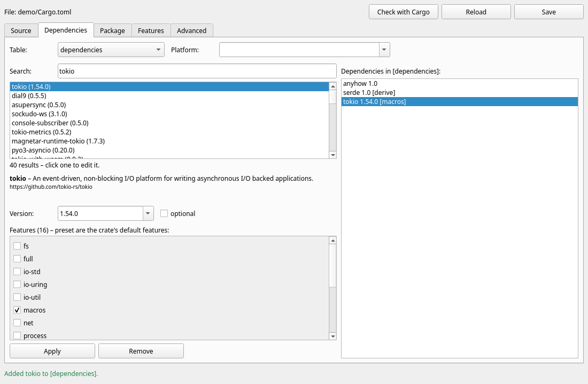
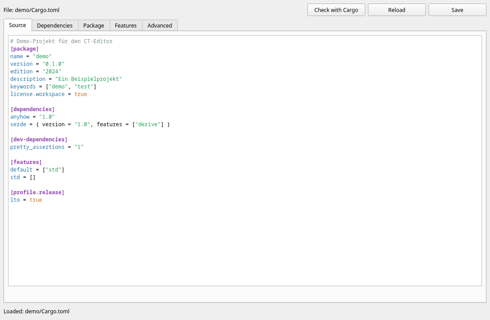
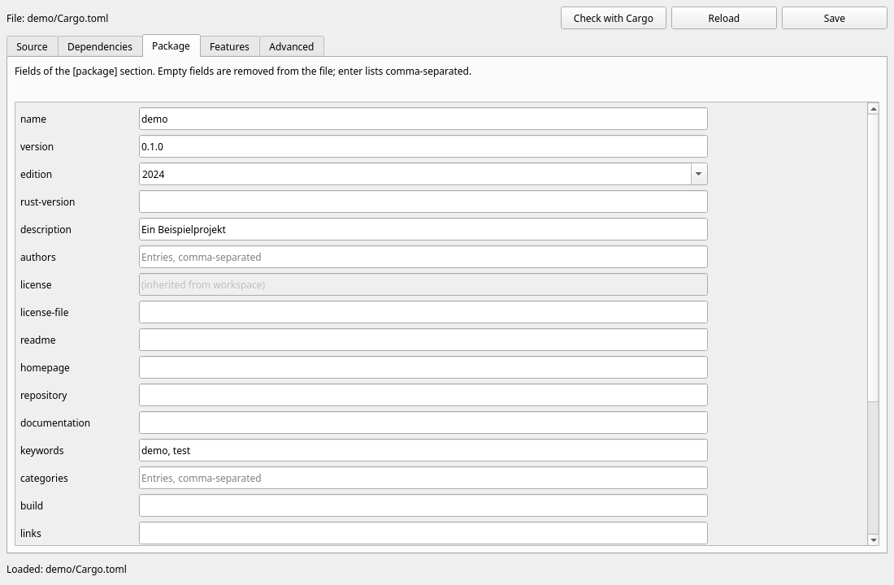

# CT-Editor – Manual

The **CT-Editor** (Cargo TOML editor) is the visual editor for `Cargo.toml` files in
the RAD tool **Freya TDE**. It runs as a standalone program that Freya TDE launches with
a language and a project folder.

🇩🇪 [Deutsche Version](../de/README.md)



## Contents

1. [Invocation](#invocation)
2. [The tabs](#the-tabs)
3. [Typical workflows](#typical-workflows)
4. [Keyboard shortcuts](#keyboard-shortcuts)
5. [Languages](#languages)
6. [For developers](#for-developers)
7. [Working with AI](#working-with-ai)

## Invocation

```bash
ct-editor --lang en --path /path/to/project     # how Freya TDE launches the editor
ct-editor -l de ./my-project                    # path also accepted positionally
ct-editor --help                                # all options
```

| Option | Meaning |
|---|---|
| `PROJECT_DIR` / `-p, --path` | folder containing `Cargo.toml` (default: current folder) |
| `-l, --lang` | language, e.g. `de`, `en`, `de_DE.UTF-8` (default: `LANG`, else English) |
| `--locales DIR` | load additional translation files |
| `--tab` | start tab: `source`, `dependencies` (default), `package`, `features`, `advanced` |
| `--offline` | no connection to crates.io |
| `--screenshot IMAGE.png` | save the window as an image and exit (works headless) |
| `--size 1100x720` | window size |
| `--embedded` | started by Freya TDE: no File menu, the language is not saved |

**If the folder has no `Cargo.toml`,** the editor prepares a new one (package name =
folder name, version 0.1.0, edition 2024). The file is only created when saving; until
then the header says “New file”. An existing file is loaded automatically – even if it
contains syntax errors (they are highlighted).

Exit code: `0` on normal termination.

**Standalone or inside Freya TDE:** started on its own, the editor has a **File** menu
with *Open …* (Ctrl+O, another `Cargo.toml`), *Language* (switches the interface at
once; unsaved changes are kept) and *Quit* (Ctrl+Q). It remembers the chosen language in
`~/.config/ct-editor/settings.toml` (macOS `~/Library/Application Support/ct-editor/`,
Windows `%APPDATA%\ct-editor\`); `--lang` takes precedence. Freya TDE starts it with
`--embedded`: no menu, Freya TDE decides file and language.

On Linux the editor runs natively on Wayland; GTK hands its program icon to the window
manager itself (protocol `xdg-toplevel-icon`, e.g. KDE Plasma 6.1 and later).

## The tabs

### 1 · Source



`Cargo.toml` as text with syntax highlighting. After every typing pause (300 ms) the
TOML syntax is checked:

- **valid** → all other tabs show the new state;
- **invalid** → the error line is highlighted in red, line/column/cause appear below
  and in the status bar, and the visual tabs are **locked** so nothing overwrites the
  text. `F2` jumps to the error.

Comments, blank lines and ordering are preserved by all tabs – only what was actually
changed changes.

### 2 · Dependencies (visual layer)

| Area | Function |
|---|---|
| **Table** | `dependencies`, `dev-dependencies` or `build-dependencies` |
| **Platform** | empty = all; e.g. `cfg(unix)` → `[target.'cfg(unix)'.dependencies]` |
| **Search** | searches crates.io – **only from 3 characters on** and after a short typing pause (Enter searches immediately) |
| **Results** | the crates found, with their recommended version |
| **Details** | after clicking a result: short description, link, version, *optional* |
| **Features** | all features of the chosen version as check boxes. **Preset = the crate's default features.** Tooltip: what a feature enables |
| **Add / Apply** | writes the dependency into the manifest |
| **Remove** | deletes the selected dependency |
| **list on the right** | all dependencies of the chosen table; a click loads one for editing |

The resulting entry – like `cargo add`:

| Selection | Result |
|---|---|
| default features only | `serde = "1.0.229"` |
| defaults + `derive` | `serde = { version = "1.0.229", features = ["derive"] }` |
| default `std` deselected, `rc` selected | `serde = { version = "1.0.229", default-features = false, features = ["rc"] }` |
| *optional* checked | `…, optional = true` |

The version is freely editable (`1.0`, `^0.9`, `=1.2.3`); the feature list follows the
matching version. Existing styles are preserved: a `[dependencies.tokio]` table stays a
table, unknown keys (`registry`, `branch` …) stay, an alphabetically sorted table stays
sorted. Path, git and workspace dependencies can be edited as well.

### 3 · Package



A form for `[package]`: name, version, edition, rust-version, description, authors,
license, links, keywords, categories, build script, publish, auto* switches … Every
input takes effect immediately; an empty field is removed, lists are entered
comma-separated. Fields inherited from the workspace (`license.workspace = true`) are
marked and can only be changed in the source. Tooltips explain every field.

### 4 · Features

The package's own features (`[features]`): pick a feature or **New**, enter name and
enabled entries (`std, dep:serde, serde/derive`), **Apply**. Changing the name of a
selected feature and applying renames it.

### 5 · Advanced

Every section of the file individually as TOML – this makes the **full scope** of a
`Cargo.toml` reachable: `[lib]`, `[[bin]]`, `[[example]]`, `[[test]]`, `[[bench]]`,
`[profile.*]`, `[workspace]`, `[lints]`, `[patch]`, `[replace]`, `[badges]`,
`[target.*]`, `[package.metadata]` … New sections are created from **templates**.
Invalid TOML is not applied; the error line is highlighted.

### Toolbar

| Button | Function |
|---|---|
| **Save** | writes the file (creating the folder if needed). Nothing is saved while there is a syntax error |
| **Reload** | reads the file again (asks if there are unsaved changes) |
| **Check with Cargo** | lets Cargo itself validate the manifest (`cargo metadata --no-deps --offline`): required fields, valid edition, workspace references … |

When closing with unsaved changes, the editor asks first.

## Typical workflows

**Add a crate:** *Dependencies* tab → type `serde` → click the result `serde` → check
feature `derive` → **Add** → `Ctrl+S`.

**Change features of an existing dependency:** click it in the list on the right →
check/uncheck → **Apply**.

**Platform-specific dependency:** *Platform* = `cfg(windows)` → search → add.

**Create a release profile:** *Advanced* tab → template `profile` → **Insert template**
→ adjust → **Apply**.

## Keyboard shortcuts

| Key | Function |
|---|---|
| `Ctrl+S` | save |
| `F5` | check with Cargo |
| `F2` | jump to the syntax error |
| `Enter` in the search field | search immediately |

## Languages

Texts live in `locales/<language>.toml` (embedded: `de`, `en`). A missing language
falls back to the primary language (`de-AT` → `de`) and then to English.

**New language without recompiling:** copy `locales/en.toml` to e.g. `fr.toml`,
translate the values, keep keys and `{placeholders}` unchanged, then:

```bash
ct-editor --locales /path/to/my/locales --lang fr --path project
```

Files in the `--locales` folder also extend or override embedded languages. To embed a
language permanently, put the file into `locales/` and register it in `src/i18n.rs`
(`EMBEDDED`) – the test `languages_are_complete` ensures all keys are present.

## For developers

### Requirements

Rust ≥ 1.99 and, on Linux, GTK 4 with development files (Windows and macOS need nothing else) –
the same as for RUF (<https://github.com/Dragon-InterActive/RUF>, `docs/en/getting-started.md`).

RUF comes via Git from its repository (`Cargo.toml`), inside Freya TDE as well; the
version is pinned in `Cargo.lock`. After a new RUF version: `cargo update -p ruf -p rncl`.

```bash
cd CT-Editor
cargo run -- --lang en --path .                      # start the editor (standalone, with menu)
cargo test                                           # logic and GUI tests (Linux without a display: xvfb-run -a cargo test)
cargo test -- --ignored live_crates_io               # test against the real crates.io
cargo clippy --all-targets                           # must be warning-free
```

### Structure

```
CT-Editor/
├── src/
│   ├── main.rs          start-up: CLI, language, Application, editor
│   ├── lib.rs           library (everything except main.rs is reusable)
│   ├── cli.rs           command line (clap)
│   ├── i18n.rs          translations, tr! macro
│   ├── manifest.rs      Cargo.toml model on toml_edit (no UI)
│   ├── features.rs      feature check boxes ⇄ features/default-features (no UI)
│   ├── crates_io.rs     crates.io client + CrateSource trait (no UI)
│   ├── cargo_cli.rs     validation via cargo metadata (no UI)
│   └── ui/              user interface (RUF/RNCL)
│       ├── mod.rs       editor, shared state, save/load/check
│       ├── source_tab.rs, deps_tab.rs, package_tab.rs, features_tab.rs, advanced_tab.rs
├── locales/             de.toml, en.toml
├── tests/gui.rs         GUI integration tests (real toolkit)
├── examples/remote_control.rs   drive the editor from code
└── docs/                this documentation (de, en, images)
```

**Data flow:** there is exactly one `Manifest` in the shared state. Visual tabs change
it through `Shared::modify(origin, |m| …)`; afterwards the source text is regenerated
and all *other* tabs are refreshed. The source tab parses after the typing pause
(`Shared::apply_source_text`). While tabs are being filled, all handlers ignore their
signals (`Shared::is_refreshing`, helper `weak1`).

**Network:** search and details run on `std::thread`s; results reach the GUI thread
through `ruf::GuiSender`. Generation counters discard outdated replies, fetched details
are cached per session. The user agent names the project, as the crates.io policy
requires.

### Why `toml_edit` instead of `cargo add`?

`toml_edit` is the library Cargo itself (`cargo add`, `cargo remove`) uses to edit
manifests – same formatting rules, comments are preserved. Unlike running `cargo add`,
it works on the text *in the editor* (even unsaved), instantly and without network.
Validity for Cargo is then checked by **Cargo itself** (`cargo metadata`, button
*Check with Cargo*).

### Using the logic as a library

Everything except the UI runs without a GUI toolkit – e.g. directly inside Freya TDE:

```rust
use ct_editor::manifest::{DepKind, DepTable, Dependency, Manifest};

let text = std::fs::read_to_string("Cargo.toml")?;
let mut manifest = Manifest::parse(&text)?;            // errors carry line/column

let mut dep = Dependency::new("serde", "1.0.229");
dep.features = vec!["derive".into()];
manifest.set_dependency(&DepTable::new(DepKind::Normal), &dep);
manifest.set_package_text("description", "My project");
manifest.set_feature("default", &["std".into()]);

std::fs::write("Cargo.toml", manifest.to_text())?;
```

Selecting features of a version like the editor does:

```rust
use ct_editor::crates_io::{CratesIo, CrateSource};
use ct_editor::features::{apply_selection, feature_states};

let details = CratesIo::new().details("tokio")?;
let version = details.recommended().unwrap();
let mut states = feature_states(&version.features, None);   // defaults on
for s in &mut states { if s.name == "full" { s.enabled = true; } }
let mut dep = Dependency::new("tokio", version.num.clone());
apply_selection(&mut dep, &states);                          // features = ["full"]
```

Custom crate source (mirror, company registry, tests): implement the `CrateSource`
trait or use `StaticSource`, and pass it in `EditorOptions::source`.

### Driving the editor from code

All widgets are reachable through `editor.shared()` – for tests, Freya TDE and AI
agents. Complete example: `examples/remote_control.rs`.

```rust
let editor = Editor::open(EditorOptions { project_dir: "demo".into(), source, size: (1100, 720) });
let deps = &editor.shared().deps;
deps.search.set_text("serde");                     // search starts after the pause
// … process events until deps.results.count() > 0 …
deps.results.set_current_index(0);                 // click the result
// … wait until deps.apply.is_enabled() …
deps.apply.click();                                // add it
editor.save()?;
```

### Tests

| Level | Location | Run |
|---|---|---|
| manifest, features, i18n, CLI, cargo | `src/*.rs` (`#[cfg(test)]`) | `cargo test --lib` |
| user interface | `tests/gui.rs` (own `main`, `harness = false`) | `cargo test --test gui` (Linux without a display: `xvfb-run -a`) |
| crates.io live | `crates_io::tests::live_crates_io` | `cargo test -- --ignored` |

The i18n test `every_used_key_exists` finds every `tr!("…")` key in the sources that
is missing from the language files.

## Working with AI

- `AGENTS.md` summarises rules and commands for AI assistants.
- The skill `.claude/skills/ct-editor/SKILL.md` describes typical tasks (new tab, new
  package field, new language, debugging).
- **Visual check without a screen:** `ct-editor --offline --tab package --screenshot /tmp/p.png`
  or `xvfb-run -a cargo run --example remote_control -- demo serde derive /tmp/d.png en`
  – then look at the image.
- The RUF skills (`.claude/skills` in the RUF repository, `../RUF` inside Freya TDE) apply here as well.
